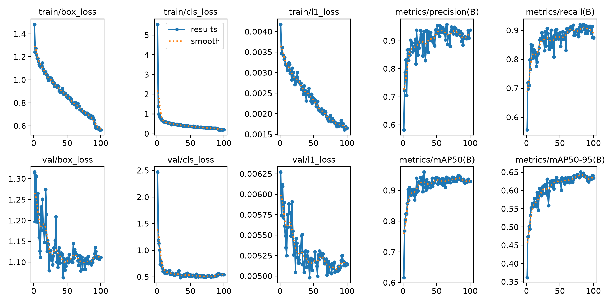

# League of Legends Object Detection & Tracking

리그 오브 레전드 게임 화면에서 **챔피언, 미니언, 오브젝트**를 탐지하고 추적하는 YOLO26 Fine-tuning 프로젝트입니다.

## 1. 프로젝트 개요

- **모델:** YOLO26n, YOLO26s
- **탐지 클래스:** Champion, Minion, Object
- **프레임워크:** PyTorch, Ultralytics
- **학습 환경:** NVIDIA RTX A5000 24GB, CUDA 12.6
- **라벨링:** Roboflow
- **객체 추적:** ByteTrack

## 2. 학습 과정

1. 게임플레이 영상에서 이미지 1,902장 추출
2. 중복·유사 이미지 정제 후 1,189장 확보
3. 이미지 100장 수동 라벨링
4. YOLO26n Fine-tuning 후 952장 자동 라벨링 및 검수
5. YOLO26s 모델 100 Epoch Fine-tuning
6. 별도 테스트 데이터 100장으로 성능 평가

## 3. 최종 성능

**YOLO26s — Test Dataset (100 Images)**

| Class | Precision | Recall | mAP50 | mAP50-95 |
|---|---:|---:|---:|---:|
| Champion | 0.918 | 0.869 | 0.887 | 0.394 |
| Minion | 0.879 | 0.810 | 0.848 | 0.321 |
| Object | 0.981 | 1.000 | 0.995 | 0.708 |
| **All** | **0.926** | **0.893** | **0.910** | **0.474** |

### 학습 및 평가 결과



[Precision-Recall Curve](results/yolo-test-BoxPR_curve.png) · [Confusion Matrix](results/yolo-test-confusion_matrix.png)

## 4. 객체 추적 결과

YOLO26s와 ByteTrack을 이용하여 객체별 Bounding Box, 클래스, Tracking ID 및 이동 궤적을 시각화하였습니다.

**[5초 추적 결과 영상](results/track-5s.mp4)**

## 5. 설치 및 실행

```bash
pip install ultralytics opencv-python
```

GPU 사용 시 환경에 맞는 CUDA 지원 PyTorch가 필요합니다.

### 객체 탐지

```bash
yolo detect predict model=models/fine-tuned-yolo26s-best.pt source=input.mp4
```

### 객체 추적

```bash
yolo track model=models/fine-tuned-yolo26s-best.pt source=input.mp4 tracker=bytetrack.yaml line_width=1 save=True
```

이동 궤적 시각화는 [track.py](scripts/track.py)를 참고하세요. 실행 전 모델 및 영상 경로를 설정해야 합니다.

## 6. 프로젝트 파일

| 파일 | 설명 |
|---|---|
| [train.py](scripts/train.py) | Fine-tuning 코드 |
| [auto_label.py](scripts/auto_label.py) | 자동 라벨링 코드 |
| [track.py](scripts/track.py) | 객체 추적 코드 |
| [YOLO26s 모델](models/fine-tuned-yolo26s-best.pt) | 최종 학습 가중치 |
| [YOLO26n 모델](models/fine-tuned-yolo26n-best.pt) | 초기 학습 가중치 |
| [학습 설정](configs/fine-tuned-yolo26s-args.yaml) | 최종 Fine-tuning 설정 |
| [학습 환경](requirements-server.txt) | Python 패키지 목록 |

## 7. 참고 자료

- [Ultralytics YOLO26](https://docs.ultralytics.com/models/yolo26/)
- [Ultralytics Tracking](https://docs.ultralytics.com/modes/track/)
- [Roboflow](https://roboflow.com/)
